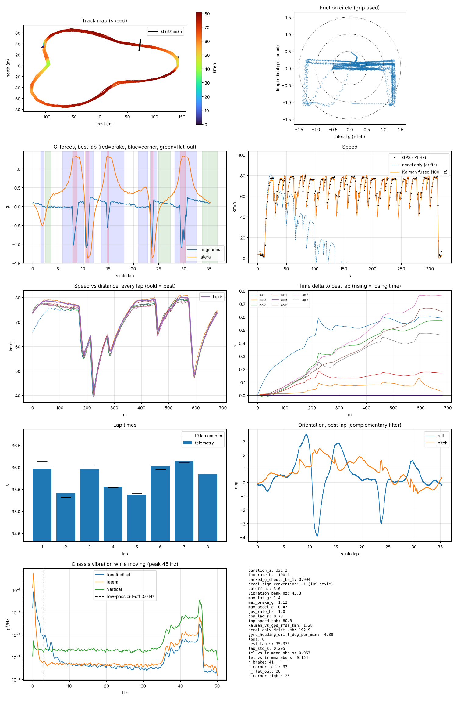

# PocketPitStop

Go-kart telemetry from a phone. Mount a phone on the kart, record a session, and get what race engineers look at: g-forces, a friction circle, braking and cornering events, speed, a track map, lap times and lap-to-lap time deltas.

Everything runs in the browser: the page records the phone's motion sensors and GPS, then analyses them with Python running locally through [Pyodide](https://pyodide.org). Nothing is uploaded to a server. The same Python pipeline also runs from the command line.


*Dashboard from a simulated session (generated test data, not a real kart).*

## Recording a session

### In the browser (no app needed)

1. Mount the phone rigidly to the chassis (not the steering column). Nobody touches it while driving.
2. Open the site in Safari, tap **Start recording**, and allow motion and location access.
3. Keep the kart still for the 10-second countdown. That parked moment is how the software finds "down".
4. Drive. Keep Safari open with the screen on: if the screen locks or you switch apps, recording pauses. The page asks the phone to keep the screen awake; if it can't, set Auto-Lock to Never (Settings, Display & Brightness) for the session.
5. Tap **Stop and analyse**. Tap **Save recording** to keep the raw data.

The recorder saves its data in the same layout as a Sensor Logger export (`TotalAcceleration.csv`, `Gyroscope.csv`, `Location.csv` in a zip), so both recording methods go through exactly the same analysis.

### With the Sensor Logger app (better for long sessions)

The free Sensor Logger app records in the background and at a higher sample rate (100 Hz, vs typically around 60 Hz in Safari).

1. Turn on **Accelerometer, Gravity, Gyroscope and Location**, at the highest sample rate.
2. Start recording, sit still ~10 s, drive.
3. Export as **Zipped CSV** and choose it under "Or analyse a Sensor Logger recording".

Optional for either method: the IR lap counter's lap times (CSV, seconds in the last column) to compare against, and the start/finish line as `LAT1,LON1,LAT2,LON2` (otherwise it's placed on the main straight automatically).

## Deploying to Vercel

It's a static site: no build step, no server code.

```
PocketPitStop/
├── index.html              ← the web app (recorder + analysis UI)
├── py/
│   ├── kart_telemetry.py   ← the analysis pipeline
│   └── sim_session.py      ← simulated test session generator
├── docs/dashboard-simulated.png
└── README.md
```

**From GitHub:** push this repo → Vercel → Add New → Project → import it → Framework preset **Other**, leave build command empty → Deploy.

**From the CLI:** run `npx vercel --prod` in this folder.

Vercel serves it over HTTPS, which Safari requires for motion and location access. After deploying, press **Try a simulated session** first. The first analysis downloads about 40 MB (Python + numpy, scipy, pandas, matplotlib from the Pyodide CDN) and can take up to a minute; after that it's cached. The recorder starts that download in the background while you drive.

## Command line

```
pip install numpy scipy pandas matplotlib
python py/kart_telemetry.py session.zip
python py/kart_telemetry.py session.zip --ir ir_laps.csv --line LAT1,LON1,LAT2,LON2 --cutoff 3
```

Outputs go to `telemetry_out/`: `dashboard.png`, `laps.csv`, `events.csv`, `telemetry.csv` (100 Hz), `summary.json`.

No recording yet? Make a simulated one with a known answer:

```
python py/sim_session.py fake.zip --seed 1
python py/kart_telemetry.py fake.zip --ir fake_ir_laps.csv --line "$(python -c "import json;print(json.load(open('fake_truth.json'))['line'])")"
```

## How it works

1. **Record.** In the browser: `devicemotion` (acceleration including gravity, rotation rate) and `geolocation.watchPosition` (position, speed, accuracy), with a screen wake lock. Or Sensor Logger's export.
2. **Align.** The phone's x/y/z don't match the kart's. Gravity while parked gives "down"; the horizontal direction whose acceleration best explains GPS speed changes (least squares) gives "forward". Phones and browsers disagree on the accelerometer's sign, so it's checked: sideways g must point the same way as the GPS track's turning.
3. **Sync.** Motion sensors (60–100 Hz) and GPS (~1 Hz) are resampled onto one 100 Hz timeline. Phone GPS arrives late, so its delay is measured by cross-correlating GPS speed changes with the accelerometer, and removed. The gyro is checked against how fast the GPS track turns, which catches degrees vs radians and sign mix-ups.
4. **Filter.** Karts have no suspension, so a 4th-order zero-phase Butterworth low-pass (default 3 Hz) removes chassis vibration. The dashboard's vibration spectrum shows the trade-off.
5. **Fuse.**
   - Kalman filter for speed: state = [speed, accelerometer bias]; predicts at 100 Hz from the accelerometer, corrects at ~1 Hz with GPS speed.
   - Complementary filter for roll and pitch: gyro for fast changes, gravity for the slow truth, with cornering and braking acceleration removed first so they aren't mistaken for tilt.
6. **Detect.** Threshold + minimum-duration rules for braking, left/right corners and flat-out stretches. Laps are timed where the GPS track crosses the start/finish line; the moment between two GPS fixes is found using the fused 100 Hz distance rather than assuming constant speed.
7. **Visualise.** Track map coloured by speed, friction circle, g-forces with events, GPS vs accelerometer-only vs Kalman speed, speed and time delta by distance for every lap, lap times vs IR, roll/pitch, vibration spectrum.

## Validation

**Analysis, on simulated sessions** (random phone mount, engine vibration, noisy 1 Hz GPS with 0.4–0.8 s delay, both accelerometer sign conventions, gyro in the wrong units or sign):

| Check | Result |
|---|---|
| Laps found | 8 of 8 |
| Lap time vs true / IR | within 0.15 s (mean ~0.07 s); limited by 1 Hz GPS position error |
| Phone-to-kart axes | lateral g correlation 1.00, longitudinal 0.99 |
| Kalman speed vs true | ~1.2 km/h RMS |
| GPS delay found | 0.40 s (true 0.40), 0.78 s (true 0.80) |
| Roll / pitch | within ~1° (zero = parked attitude) |

**Browser recorder:** a simulated session was replayed into the page as 60 Hz motion events plus GPS updates in headless Chrome, and the real pipeline was run on the zip it saved: 2 of 2 laps, each within 0.09 s of the true time; lateral g correlation 0.998; GPS delay 0.38 s (true 0.40).

**On a real kart:** not yet done. Next step: record a session, compare telemetry lap times with the IR lap counter, check the parked reading is 1.000 g and similar laps give similar traces. The browser recorder hasn't been run on a physical iPhone yet.

## Limits

- 1 Hz phone GPS is fine for a track map but limits lap timing to roughly ±0.1 s.
- Browser recording needs the page open with the screen on, and Safari typically delivers motion at around 60 Hz, which aliases engine vibration in the spectrum. Use Sensor Logger for long sessions or vibration analysis.
- Roll and pitch on a kart are only a few degrees; the phone estimate is good to about a degree.
- Without GPS, the accelerometer's sign convention can't be checked, so left and right may be swapped (the script warns).
- Event thresholds live in `TH` at the top of `kart_telemetry.py` and may need tuning per kart and track.
